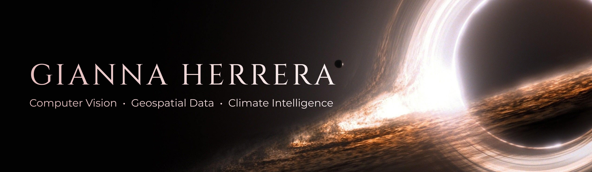
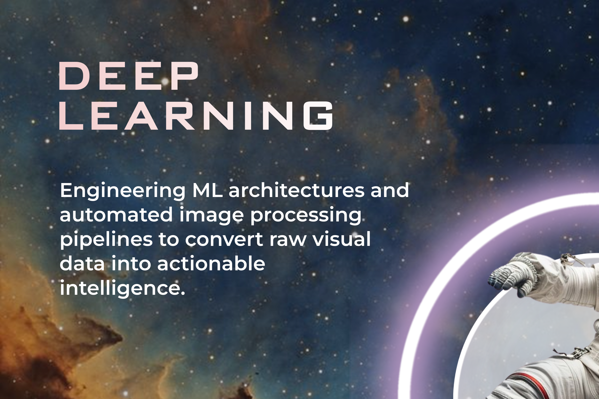
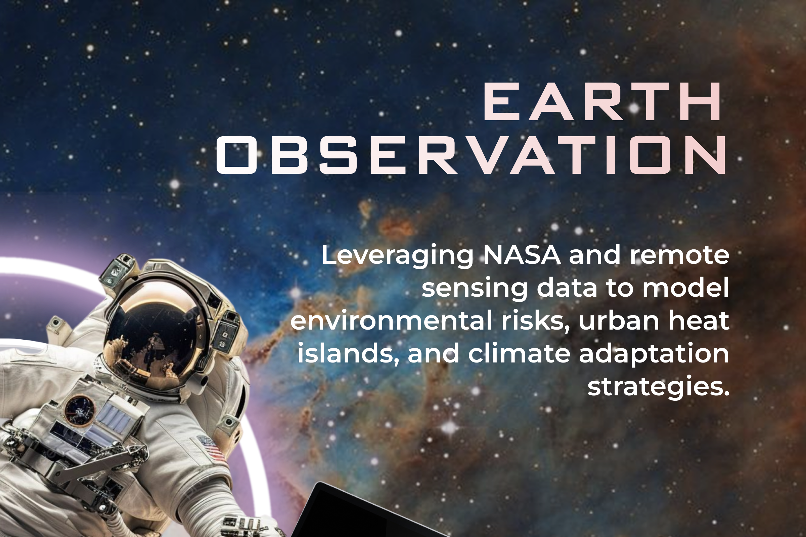
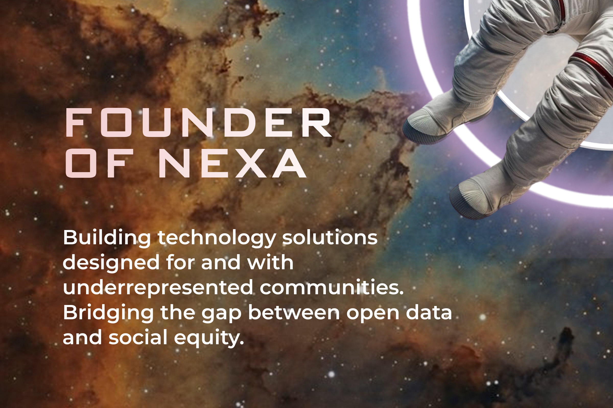
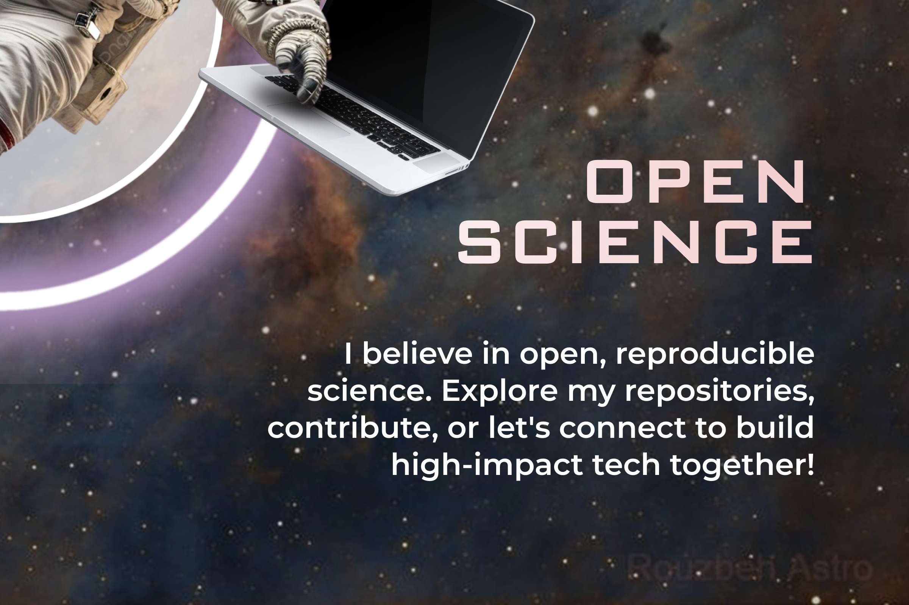

<div align="center">



<table>
<tr>
<td width="50%"></td>
<td width="50%"></td>
</tr>
<tr>
<td width="50%"></td>
<td width="50%"></td>
</tr>
</table>

<br/>


</div>

<br/>

<div align="center">
  <a href="https://www.linkedin.com/"></a>
  <a href="mailto:youremail@example.com"></a>
  <a href="#"></a>
</div>

<br/>

## 🕳️ TARS, begin mission log

> *"We used to look up at the sky and wonder at our place in the stars. Now we just look down, and worry about our place in the dirt."*

I'm a **Software Engineering student** and founder of **Nexa**, building artificial intelligence that looks upward — satellites, climate, geospatial data — to solve problems that are, quite literally, down here. My work bridges **computer vision**, **Earth observation**, and **climate resilience**, driven by the belief that responsible technology can open a wormhole between innovation and the communities that need it most.

```
CURRENT COORDINATES
> Location:   Low Earth Orbit / NASA Citizen Science
> Mission:    Responsible AI for climate intelligence
> Payload:    Computer Vision · Geospatial Data · Deep Learning
> Status:     Transmitting data... [OK]
```

<br/>

## 🌌 Mission Log — Research & AI

<table>
<tr>
<td width="140" valign="top"><b>2026 — Present</b></td>
<td>
<b>Research Contributor</b> · NASA Citizen Science & Open Data<br/>
<sub>
🛰️ Developing computer vision models and ML pipelines using satellite imagery (Landsat, Sentinel)<br/>
🌍 Processing Earth observation data via NASA Earthdata to analyze land cover and microclimate dynamics<br/>
🔬 Designing end-to-end deep learning workflows in Python + PyTorch for environmental monitoring<br/>
🤝 Interdisciplinary initiatives connecting AI, environmental science, and social impact
</sub>
</td>
</tr>
<tr>
<td valign="top"><b>Jul 2026 — Present</b></td>
<td>
<b>Research Trainee</b> · Climate Change AI — Virtual Summer School<br/>
<sub>
📡 International research program applying AI to climate change challenges<br/>
🧠 Developing technical skills in ML for environmental and geospatial data<br/>
🌱 Investigating AI approaches for climate adaptation and ecological monitoring
</sub>
</td>
</tr>
<tr>
<td valign="top"><b>2025 — Present</b></td>
<td>
<b>Founder & Technology Lead</b> · Nexa<br/>
<sub>
🚀 Building technology solutions for underserved communities and nonprofit organizations<br/>
🧭 Directing strategy, partnerships, and scalable digital products with social impact<br/>
👥 Coordinating multidisciplinary teams across engineering, communications, and outreach
</sub>
</td>
</tr>
<tr>
<td valign="top"><b>2025 — Present</b></td>
<td>
<b>Advisory Board Member</b> · Women in Leadership with AI-Driven Engagement
</td>
</tr>
<tr>
<td valign="top"><b>Jul 2026 — Present</b></td>
<td>
<b>Advisory Board Member</b> · Pompea College of Business, University of New Haven<br/>
<sub>
💡 Providing strategic insights on AI, technology, leadership, and social innovation<br/>
⚖️ Contributing to discussions on responsible AI, governance, and the future of leadership in data-driven environments
</sub>
</td>
</tr>
<tr>
<td valign="top"><b>2026</b></td>
<td>
<b>Aspire Leaders Program</b> · Aspire Institute (designed by Harvard Business School)<br/>
<sub>
🏆 Achieved a perfect final assessment score (100/100) and graduated among <b>10,588 finalists</b> selected from more than <b>50,000 participants</b>
</sub>
</td>
</tr>
</table>

<br/>

## 🪐 Technical Payload

<div align="center">

**Artificial Intelligence & Machine Learning**


**Geospatial & Climate Technologies**


**Software Engineering**


**Infrastructure & Tools**


</div>

<br/>

## 🌠 Final Transmission

> *"We are not meant to save the world. We are meant to leave it."* — reinterpreted: I don't settle for observing Earth through data alone; I build tools so others can care for it better.

<div align="center">
<sub>Thank you for reading to the end of this transmission. This signal is sent through <b>Nexa</b>, powered by <b>NASA</b> data, and driven by the belief that technology can cross any event horizon.</sub>
</div>

<br/>

<div align="center">

</div>